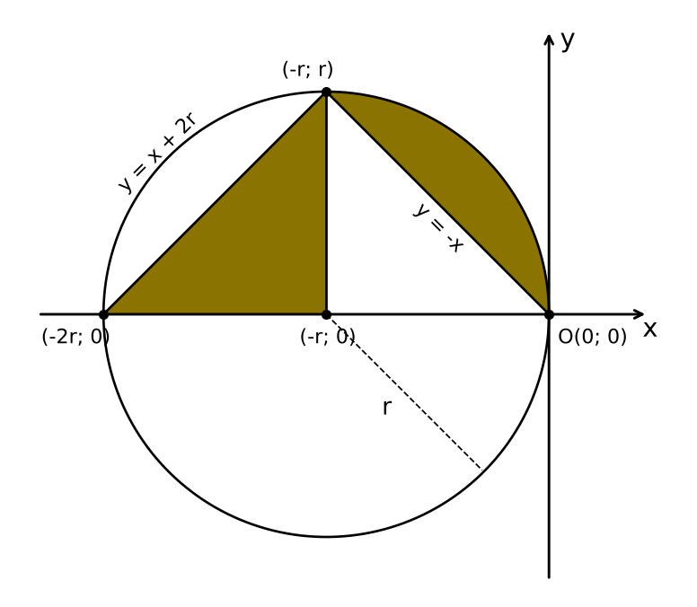

# Лабораторна робота №3 — «Реалізація алгоритмів з розгалуженням мовою C++»

**Дисципліна:** Алгоритмізація та програмування
**Виконав:** Онищук Тарас, група 311
**Варіант 29:** If3, If38, геометрична область №31

## Завдання

| № | Функція | Задача |
|---|---|---|
| 1 | `task_if3()` | If3 — якщо число додатне, відняти 8; від'ємне — додати 6; нуль — замінити на 10 |
| 1 | `task_if38()` | If38 — значення функції r(x): x² − 4 при x < −2; x при −2 ≤ x ≤ 2; 4 при x > 2 (результат цілого типу) |
| 2 | `task_geom31()` | Чи належить точка (x, y) області №31 (трикутник + сегмент кола радіуса r) |
| 3 | `main()` | Меню вибору завдання через `switch` |

Усі вхідні дані перевіряються на коректність.

## Файли

- `main.cpp` — код програми
- `diagrams/` — UML діаграми активності (PlantUML-джерела `.puml` і картинки `.png`), малюнок області №31
- `screenshots/` — приклади роботи програми

## Запуск

QtCreator: *Non-Qt Project → Plain C++ Application*, замінити вміст `main.cpp` і запустити.
Або з консолі: `g++ main.cpp -o lab3 && ./lab3`

